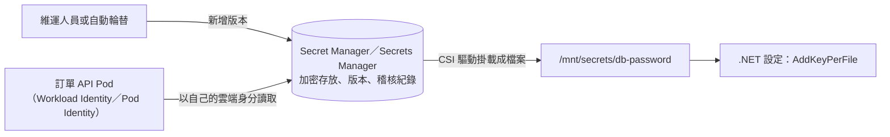

## 這是什麼

電商後端到處都有機密：資料庫密碼、Redis 與 RabbitMQ 的密碼、金流的 webhook 密鑰、寄信服務的 API 金鑰。它們一旦外洩，攻擊者就能讀取訂單資料、偽造付款通知、用你的帳號寄送垃圾信。

**機密管理**要回答四個問題：機密存在哪裡、誰可以讀、程式怎麼拿到、怎麼更換（輪替）。雲端提供專門的服務：GCP 的 **Secret Manager**、AWS 的 **Secrets Manager**。它們加密存放機密、以 IAM 控制誰能讀取、記錄每一次存取，並支援版本與輪替。

## 運作原理



Pod 以自己的雲端身分（[GKE 工作負載身分](/platforms/gke/workload-identity/)或 [EKS Pod Identity](/platforms/eks/pod-identity/)）讀取機密，IAM 只授權它讀取需要的那幾個機密。機密透過 Secrets Store CSI 驅動掛載成檔案，或由應用程式在啟動時用 SDK 讀取。

**輪替**：定期更換機密，縮短外洩後可被利用的時間。輪替時會有一段時間新舊機密並存：先新增新版本、讓使用方都換上新版本、確認後才停用舊版本。

## 常見錯誤與正確寫法

### 1. 機密放在程式碼、設定檔或映像中

`appsettings.json` 裡的密碼會進版本控制；寫在 Dockerfile 的 `ENV` 會留在映像的每一層；環境變數會出現在 `kubectl describe` 與當機報告中。機密只放在機密管理服務，由執行環境在執行時取得。

### 2. 所有服務共用一組萬用帳號

訂單 API、通知 Worker、報表服務都用同一個資料庫帳號與同一個機密，任何一個服務外洩就全部外洩，也無法得知是誰在存取。每個服務一組自己的帳號與機密，IAM 只授權它讀自己的機密：

```bash
# GKE：讓 order-api 的 Kubernetes ServiceAccount 只能讀取這一個機密
gcloud secrets add-iam-policy-binding shop-order-db-password \
  --role=roles/secretmanager.secretAccessor \
  --member="principal://iam.googleapis.com/projects/123456789012/locations/global/workloadIdentityPools/shop-prod.svc.id.goog/subject/ns/shop/sa/order-api"
```

AWS 上在 Pod Identity 角色的政策中，只允許 `secretsmanager:GetSecretValue` 讀取指定的機密 ARN。

### 3. 輪替後應用程式還在用舊的值

機密掛載成檔案時，CSI 驅動可以定期同步新版本；應用程式要能讀到更新後的檔案：

```csharp
// 套件：Microsoft.Extensions.Configuration.KeyPerFile
builder.Configuration.AddKeyPerFile("/mnt/secrets", optional: false, reloadOnChange: true);
```

但已經建立的資料庫連線池不會因為設定改變而換密碼。對資料庫密碼這類情況，使用支援動態密碼的機制（例如 Npgsql 的密碼提供者，見 [EKS 資料服務](/platforms/eks/data-services/)），或在輪替後重新部署。

### 4. 能不用密碼的地方還在用密碼

最好的機密是不存在的機密。Cloud SQL 與 RDS 都支援以 IAM 驗證連線，Pod 以自己的雲端身分登入資料庫，不需要任何密碼，見 [GKE 資料服務](/platforms/gke/data-services/)與 [EKS 資料服務](/platforms/eks/data-services/)。存取 GCS、S3 等雲端服務也一樣，用工作負載身分，不用存取金鑰。

## 使用邊界

- Kubernetes 的 Secret 物件只是 Base64 編碼，適合作為「把機密送進 Pod」的最後一段，不適合作為機密的唯一來源，見 [設定、Secret 與權限](/platforms/kubernetes/configuration-security/)。
- 日誌、錯誤訊息、追蹤的屬性中不能出現機密；在連線字串與 HTTP 標頭的記錄上設定遮罩。
- 第三方服務的金鑰（金流密鑰、寄信 API 金鑰）多半無法自動輪替，要建立手動輪替的程序與時間表，並在 webhook 驗證中支援新舊密鑰並存，見 [Webhook 簽章驗證](/security/webhook-signatures/)。
- 機密外洩時的處理：立即停用並輪替、檢查存取紀錄確認影響範圍，比事後追查誰改了什麼更重要。
