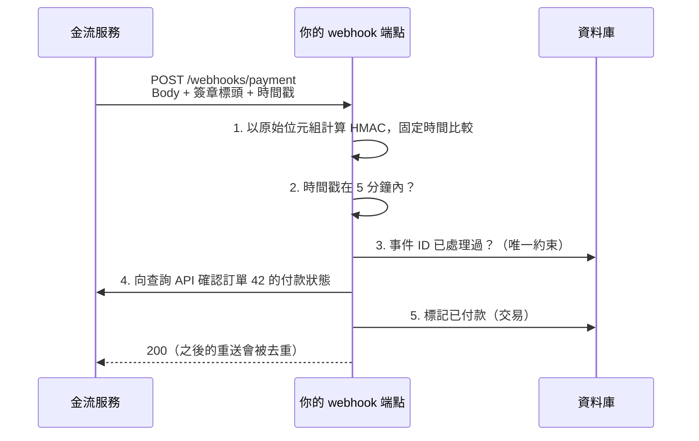

## 這是什麼

買家在金流頁面付款成功後，金流服務會呼叫你的 API（**webhook**，又稱回呼或通知），告訴你「訂單 42 已付款 1,200 元」。你的系統據此把訂單改成已付款、開始出貨。

問題是：這個端點是公開的，任何人都可以送一個看起來一模一樣的請求。如果不驗證，攻擊者就能讓沒付錢的訂單被標記為已付款。

金流服務通常用 **HMAC 簽章**證明通知是它送的：雙方事先共享一把密鑰，金流用這把密鑰對通知內容計算一個簽章並附在請求中；你用同一把密鑰重新計算，結果一致才代表內容沒被竄改、而且確實來自持有密鑰的一方。台灣常見的金流服務也採用類似的機制（例如以參數與金鑰計算檢查碼）。

## 運作原理



每一步防的是不同的攻擊：簽章防偽造與竄改、時間戳防重放（攻擊者把一個真的通知存起來，稍後再送一次）、事件 ID 防重複處理、向對方查詢則是最後一道確認。

## 常見錯誤與正確寫法

### 1. 先反序列化再計算簽章

簽章是對**原始的位元組**計算的。如果先把 JSON 反序列化成物件、再序列化回字串計算，欄位順序、空白、數字格式都可能改變，簽章永遠對不上；有些開發者因此關掉驗證，就完全失去保護。直接讀取原始內容：

```csharp
app.MapPost("/webhooks/payment", async (HttpRequest request, PaymentWebhookHandler handler, CancellationToken ct) =>
{
    using var ms = new MemoryStream();
    await request.Body.CopyToAsync(ms, ct);
    var body = ms.ToArray();                                     // 原始位元組

    if (!handler.IsAuthentic(body, request.Headers["X-Signature"], request.Headers["X-Timestamp"]))
        return Results.Unauthorized();

    var evt = JsonSerializer.Deserialize<PaymentEvent>(body)!;   // 驗證通過後才解析
    await handler.HandleAsync(evt, ct);
    return Results.Ok();
}).WithMetadata(new RequestSizeLimitAttribute(64 * 1024));
```

### 2. 用一般的字串比較驗證簽章

`==` 比較字串時，一遇到不同的字元就停止。攻擊者可以量測回應時間，逐字元猜出正確的簽章（時序攻擊）。用固定時間的比較：

```csharp
// secret（byte[]，自機密管理服務載入）與 time（TimeProvider）是這個處理器類別的欄位
public bool IsAuthentic(byte[] body, string? signatureHex, string? timestamp)
{
    if (signatureHex is null || !long.TryParse(timestamp, out var unix)) return false;

    // 時間戳超過 5 分鐘就拒絕，避免舊的通知被重放
    var sentAt = DateTimeOffset.FromUnixTimeSeconds(unix);
    if ((time.GetUtcNow() - sentAt).Duration() > TimeSpan.FromMinutes(5)) return false;

    // 依金流文件定義的格式組出要簽章的內容，這裡以「時間戳.內容」為例
    var payload = Encoding.UTF8.GetBytes($"{unix}.").Concat(body).ToArray();
    var expected = HMACSHA256.HashData(secret, payload);

    byte[] provided;
    try { provided = Convert.FromHexString(signatureHex); }
    catch (FormatException) { return false; }

    return CryptographicOperations.FixedTimeEquals(expected, provided); // 固定時間比較
}
```

簽章的確切格式（哪些內容、什麼順序、用什麼編碼）一定要依金流服務的文件實作。密鑰不要寫在程式或設定檔中，見 [機密管理](/security/secrets-management/)。

### 3. 只相信通知的內容

即使簽章正確，也只證明「通知是金流送的」。金額、狀態以金流的查詢 API 為準：收到通知後，用訂單編號向金流查詢一次，確認金額與狀態一致，才更新訂單。這也能處理「通知遺失」的情況：定期對「待付款太久」的訂單主動查詢。

### 4. 處理太久才回應，被當成失敗而重送

金流服務等不到回應會重送。驗證與去重完成後，盡快回應 2xx；後續較慢的工作（寄信、通知倉庫）交給背景處理。同一個通知被送很多次是正常的，以事件 ID 或交易編號建立唯一約束，見 [高併發 CRUD](/data-access/concurrent-crud/)。

## 使用邊界

- 如果金流服務提供來源 IP 清單，可以在負載平衡器或 WAF 加上限制，作為額外的一層；但不能取代簽章驗證。
- 密鑰要能輪替：輪替期間同時接受新舊兩把密鑰計算出的簽章，確認新密鑰生效後再停用舊的。
- webhook 端點要記錄每次收到的事件 ID、驗證結果與處理結果，用於對帳與排查。
- 其他第三方 API 的風險見 [API 安全風險](/security/api-risks/)。
